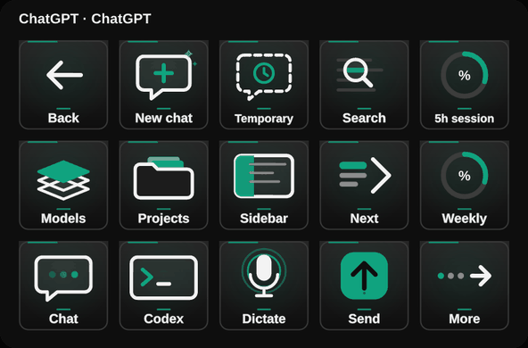
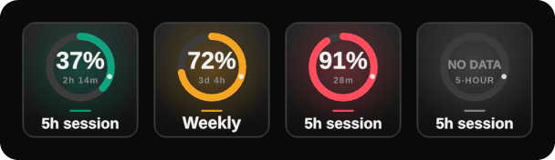
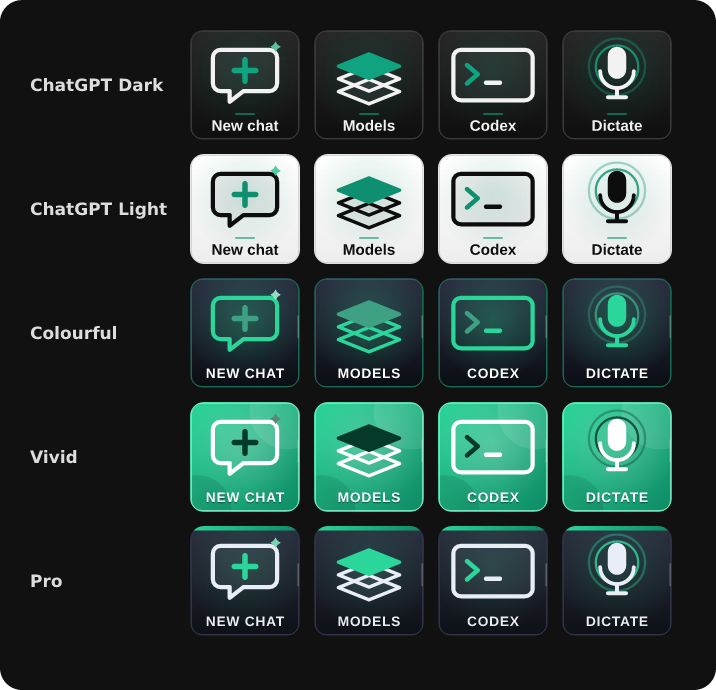
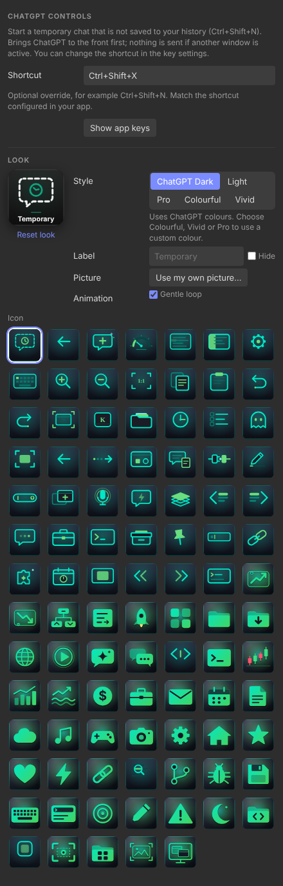

# ChatGPT Controls

Unofficial Elgato Stream Deck plugin for the **ChatGPT desktop app on Windows** (Chat, Work and Codex). Version 1.2.3.0.

Keys use the app's own documented keyboard shortcuts and `codex://` app links, so they act **inside the desktop app**. Every icon is animated.



## Install in three steps

1. Download **ChatGPTControls-Installer-1.2.3.0.zip** from [Releases](https://github.com/nikhilgs817/streamdeck_chatgpt/releases/latest).
2. Right-click the ZIP, choose **Extract All**, and open the extracted folder.
3. Double-click **Install-ChatGPTControls.cmd**. Wait for the success message; Stream Deck restarts automatically.

No Git, Node.js or build commands are needed. Windows Daily Toolkit is included for automatic app switching. The installer verifies files, backs up your setup, keeps your layouts and settings, and rolls back a failed update. [Full installation, update and recovery guide](docs/INSTALL.md).

## The keys

**Page 1 (ChatGPT):** Back · New chat · Temporary · Search · 5h session / Models · Projects · Sidebar · Next · Weekly / Chat · Codex · Dictate · Send · More

**Page 2 (More):** Main · Settings · Shortcuts · Find · Work / Archive · Pin · Rename · Copy link · Skills / Previous · Usage · Zoom in · Zoom out · Reset zoom

Also in the action list: Quick chat, Scheduled, Full view, Go back, Go forward, Copy, Paste, Undo, Redo, Full screen, Focus app and Custom key.

| Key | What it does | How |
|---|---|---|
| New chat | Start a chat | `codex://threads/new` app link |
| Settings, Skills, Scheduled | Open that page in the app | `codex://settings`, `codex://skills`, `codex://automations` |
| Usage | Usage and limits in the app settings | `codex://settings/usage` |
| Temporary, Quick chat | Unsaved chat / quick chat | Ctrl+Shift+N, Ctrl+Alt+N |
| Search | Command menu (chats and commands) | Ctrl+K |
| Models, Projects | Model picker / project picker | Ctrl+Shift+M, Ctrl+Alt+Shift+O |
| Chat, Work, Codex | Switch mode | Alt+1, Alt+2, Alt+3 |
| Sidebar, Previous, Next | Sidebar / previous or next chat | Ctrl+B, Ctrl+Shift+Tab, Ctrl+Tab |
| Archive, Pin, Rename, Copy link | Current chat | Ctrl+Shift+A, Ctrl+Alt+P, Ctrl+Alt+R, Ctrl+Alt+L |
| Full view, Find, Shortcuts | | Ctrl+Shift+F, Ctrl+F, Ctrl+/ |
| Zoom in/out, Reset zoom | Text size | Ctrl+=, Ctrl+-, Ctrl+0 |
| Send | Send what you typed | The app's Send button |
| Dictate | Windows voice typing into the message box | Win+H |
| Custom key | Any shortcut you type, e.g. `Ctrl+Alt+1` or `Win+H` | |

App links start ChatGPT if it is closed. Shortcut keys first bring ChatGPT to the front and **send nothing if another window stays in front**. If you changed a shortcut under **Settings › Keyboard Shortcuts** in the app, enter the same shortcut in the key's settings. The plugin never reads or stores your account data.

Open or focus ChatGPT to show these keys automatically (needs Windows Daily Toolkit); **Back** returns to your main keys. **More** and **Main** switch between the two pages.

## Usage keys (5h session, Weekly)



**5h session** and **Weekly** show how much of your ChatGPT/Codex limits you have used: a big percentage inside a ring, the time until the window resets, and a colour that turns amber at 60 % and red at 85 %. They update every minute; press one to refresh now.

No sign-in is needed: the numbers come from the app's own records in `%USERPROFILE%\.codex\sessions`, which the app updates as you use it. If nothing has been recorded yet the key shows **NO DATA**; a window that has already reset shows 0 %.

## Appearance



| Style | Look |
|---|---|
| **ChatGPT Dark** (default) | Near-black keys, white line icons, ChatGPT-green accents, bold Segoe UI labels |
| **ChatGPT Light** | White keys with the same icons |
| **Colourful** | Coloured icons on dark glass |
| **Vivid** | White icons on a bright gradient |
| **Pro** | Restrained slate keys with a thin accent strip |

Colourful, Vivid and Pro use the new **ChatGPT** colour by default and accept any of the other colours. Every icon has its own animation in a six-second loop at 12 fps; labels stay still. Turn **Gentle loop** off for a still key. You can also pick another icon, change the label or use your own picture.



## Build and verify

```sh
npm ci
npm run build
npx tsc --noEmit
npm test            # SDK workflow + animation checks
npm run test:ui     # inspector (set CHROMIUM_PATH off Windows)
npm run validate
npm run pack
npm run build:installer
npm run test:installer   # Windows only
```

The installer ZIP is `dist/ChatGPTControls-Installer-<version>.zip`; the plugin package is `dist/com.dailyops.chatgpt.v1.streamDeckPlugin`. Personal profiles, credentials, account data and build output are excluded from Git.

## Known limits

- Shortcuts are the app's documented defaults; the app may change them between versions.
- `codex://settings/usage` is not in the app's documented link list; if it opens plain Settings, choose Usage there.
- Managed PCs that run PowerShell in Constrained Language Mode can stop the shortcut keys.

## References

- [ChatGPT desktop app commands and shortcuts](https://learn.chatgpt.com/docs/reference/commands)
- [Windows Daily Toolkit](https://github.com/nikhilgs817/windows_daily_toolkit)

Not affiliated with or endorsed by OpenAI. ChatGPT is a trademark of OpenAI. The icons are original artwork. MIT license.
